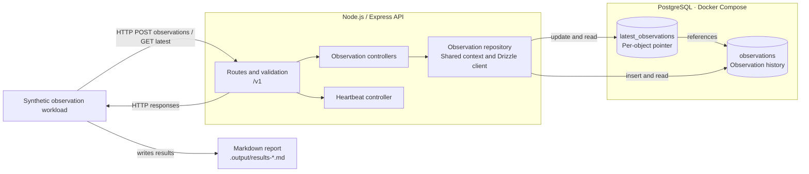

# Orbital Observation API

## Purpose

Express 5 and TypeScript 7 API for recording satellite observations in PostgreSQL and retrieving each object's latest observation.

## Architecture / Repository Overview

`src/app.ts` configures middleware and mounts the public routers under `/v1`. Controllers use the shared repository context. The observation
repository owns PostgreSQL queries and transactions. `src/data/db/client.ts` creates the pool, and `src/server.ts` manages the HTTP listener
and shuts down the pool. Drizzle schemas define committed observations and a latest-observation pointer for each object.



| Endpoint                           | Behavior                                                                                                                                                                    |
| ---------------------------------- | --------------------------------------------------------------------------------------------------------------------------------------------------------------------------- |
| `GET /v1/heartbeat`                | Returns `200` and `{"status":"ok"}` when the HTTP server can respond.                                                                                                       |
| `POST /v1/observations`            | Returns `201` with the committed observation and a `Location` of `/v1/observations/{observationId}`. Invalid input returns `400`. An existing observation ID returns `409`. |
| `GET /v1/objects/:objectId/latest` | Returns `200` with the selected observation, or `404` if the object has no observations.                                                                                    |

An observation carries a client-supplied UUID, a nonblank object identifier of up to 256 UTF-16 code units, and an ISO 8601 timestamp with
an explicit offset. Responses express the instant in UTC at millisecond precision with a year from 0001 to 9999. The API accepts older
observations, and sequential observations at the same instant keep the existing selection.

## Prerequisites and Configuration

- Node.js 24 and npm.
- Docker with Compose v2 or later for the local PostgreSQL database, which binds to `127.0.0.1:5432`.
- `PORT` defaults to `3000`. Use `0` to let the operating system select a free port.
- `CORS_ORIGIN` optionally sets the allowed browser origin. An empty value disables CORS headers.
- `DATABASE_URL` is required and points the API and Drizzle Kit at PostgreSQL. The example contains disposable Compose credentials. The
  heartbeat checks HTTP liveness. Observation requests use the database.

For local development, put overrides in `.env.development` using `.env.example` as a guide. The compiled server reads settings from its
process environment.

## Local Setup and Usage

### Local PostgreSQL

From the repository root, install dependencies, copy the example configuration if needed, and start and migrate the local database.

```sh
npm ci
test -f .env.development || cp .env.example .env.development
npm run db:start
npm run db:migrate
npm run dev
```

From another terminal, check HTTP liveness and confirm PostgreSQL has the observation tables.

```sh
curl -i http://localhost:3000/v1/heartbeat
docker compose -p orbital-observation-demo exec -T postgres psql -U orbital -d orbital_observation -c '\dt'
```

With the API running, post an observation with a fresh UUID and fetch the selected observation.

```sh
curl -i http://localhost:3000/v1/observations \
  -H 'Content-Type: application/json' \
  -d '{"observationId":"81be15be-2bc8-4457-8c19-c042019dbe50","objectId":"SAT-1042","observedAt":"2026-11-07T13:05:00.123-05:00"}'
curl -i http://localhost:3000/v1/objects/SAT-1042/latest
```

After changing a Drizzle schema, use `npm run db:generate -- --name=describe_schema_change` to generate the SQL and snapshot, then apply the
migration with `npm run db:migrate`.

### Observation workload

With the local API and its migrated database running, submit a concurrent batch of synthetic observations and verify the latest state.

```sh
npm run demo:reproduce
```

The default profile sends 160 observations per round for four objects with up to 80 requests in flight, across two rounds using seed 73. The
alternate profile uses one larger round.

```sh
npm run demo:reproduce -- --observations 500 --concurrency 80 --objects 2 --rounds 1 --seed 17
```

Use `--base-url` for a different local HTTP origin (default `http://127.0.0.1:3000`) and `--timeout-ms` for a different per-request timeout
(default 5000). Concurrency is capped at 200 and both concurrency and object count must fit the observation count. The seed controls
submission order. Each invocation and round uses fresh synthetic IDs, so earlier data cannot affect verification.

Each invocation saves a Markdown report to `.output/results-<timestamp>-<process-id>.md` in the project root and prints its path to the
terminal. The folder is ignored by Git. The report uses tables for the workload settings, round summaries, and expected and actual
observations for each mismatch.

A lost response leaves the affected object's commit outcome unknown and its result inconclusive. Exit code `0` means the run was clean, `1`
means it found a confirmed mismatch, and `2` means an input, request, or verification failure prevented a clean result. If a run has both a
mismatch and failures, it exits with `1`.

### Checks and compiled server

```sh
npm run format:check
npm run typecheck
npm test
npm run build
```

Set `DATABASE_URL` in the process environment before running `npm start`. Stop the development server first if using the same port.

### Database integration tests

With Docker running, run the integration suite. Testcontainers starts PostgreSQL on a dynamically assigned port, applies the checked-in
migrations, and removes the container after the test. Run `npm test` for the HTTP suite without Docker.

```sh
npm run test:integration
```

## Teardown / Cleanup

Stop the API before deleting or resetting the database.

- `npm run db:start` starts the local Compose database and waits for it to be healthy.
- `npm run db:delete` removes the local container, network, and PostgreSQL volume, including all local data.
- `npm run db:reset` checks that `.env.development` points to `127.0.0.1:5432/orbital_observation` without URL query parameters, then
  deletes and recreates the local database and applies migrations using that connection.

The PostgreSQL image and local environment file remain on disk.
